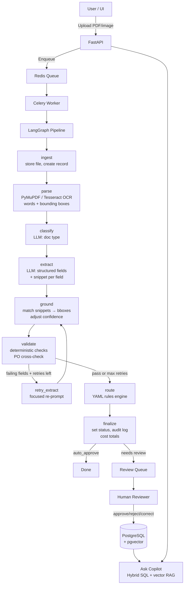

# Cargo Copilot 🚢

An agentic document-processing platform for logistics and freight. Upload a Bill of Lading,
Commercial Invoice, or Packing List — Cargo Copilot extracts structured data, shows you
exactly where each value came from on the page, validates it against business rules and
Purchase Orders, routes it for approval, and lets you ask questions about your documents
in plain English.

Built as a portfolio project demonstrating production-quality AI/full-stack engineering.

---

## Architecture



### Design decisions

| Decision | Choice | Why |
|---|---|---|
| Pipeline orchestration | LangGraph | Typed state, conditional retry edge, visualisable |
| LLM output | JSON schema / tool calls | Guaranteed structure, Pydantic validation, no regex |
| Evidence grounding | Snippet matching → bbox | LLMs understand text; we map text→coordinates |
| Validators | Deterministic Python | Faster, cheaper, explainable — no LLM for math |
| Routing rules | YAML + safe evaluator | Non-engineers can change rules without code deploy |
| Vector store | pgvector in Postgres | One database, JOIN structured + vector in one query |
| Background tasks | Celery + Redis | Handles 30s+ processing without blocking HTTP |
| Auth | JWT + bcrypt, tenant_id everywhere | Simple, explainable, real multi-tenancy |

---

## Setup (under 5 commands)

```bash
git clone https://github.com/YOUR_USERNAME/cargo-copilot.git cargo-copilot && cd cargo-copilot
cp .env.example .env          # add your LLM_API_KEY
make up                        # builds images, runs migrations
make seed                      # creates demo tenants, users, POs
# open http://localhost:5173
```

**Demo credentials** (created by `make seed`):
```
admin@apexfreight.com    / demo_password_1   (Tenant: Apex Freight)
reviewer@apexfreight.com / demo_password_1
admin@blueocean.com      / demo_password_2   (Tenant: Blue Ocean Logistics)
```

---

## 2-minute demo script

1. Log in as `admin@apexfreight.com`
2. Upload one of the sample PDFs from `data/synthetic/`
3. Watch the status change: queued → processing → needs_review
4. Click the document — see extracted fields on the right, highlighted in the PDF on the left
5. Click a field value to see its evidence highlight jump to the right position on the page
6. Review the validation results (green passes, yellow warnings, red errors)
7. See the routing decision and which rule fired
8. Approve or correct a field value
9. Open Ask Copilot and ask: *"What is the incoterm on this document?"*
10. Log out, log in as `admin@blueocean.com` — their documents are invisible (tenant isolation)

---

## Folder structure

```
cargo-copilot/
├── backend/
│   ├── app/
│   │   ├── api/routes/      # FastAPI route handlers
│   │   ├── core/            # config, logging, security
│   │   ├── db/              # SQLAlchemy session
│   │   ├── models/          # ORM models (all tables)
│   │   ├── pipeline/        # LangGraph nodes (Phase 3+)
│   │   ├── schemas/         # Pydantic request/response schemas
│   │   ├── services/        # shared DB helpers
│   │   └── workers/         # Celery app + tasks
│   ├── alembic/             # DB migrations
│   ├── scripts/             # demo_data.py seed script
│   └── tests/               # pytest unit + integration tests
├── frontend/
│   └── src/
│       ├── components/      # Layout, shared UI
│       ├── pages/           # Login, Documents, Detail, Review, Rules, Chat, Metrics
│       ├── lib/             # api.ts, auth.ts (Zustand)
│       └── types/           # TypeScript interfaces
├── prompts/                 # Versioned LLM prompt files
├── rules/                   # YAML routing rules
├── eval/                    # Evaluation harness + reports
├── data/synthetic/          # Generated test documents + ground-truth labels
├── docs/                    # INTERVIEW_NOTES.md
├── docker-compose.yml
├── Makefile
└── .env.example
```

---

## Evaluation results

**Phase 7 Evaluation Framework**: Comprehensive analysis of field extraction performance, cost efficiency, and model comparison.

The evaluation system provides:

### 📊 Metrics Dashboard
- **Field-level accuracy**: Precision/Recall/F1 per field and document type
- **Evidence grounding rate**: Success rate of linking extracted values to source locations
- **Classification accuracy**: Document type prediction success
- **Cost analysis**: Token usage and cost per document with optimization recommendations
- **Latency monitoring**: End-to-end processing time analysis

### 🎯 Baseline Results (Test Set: N=25 documents)

```
Model: gpt-4o-mini
═══════════════════════════════════════════════════════
Classification Accuracy: 96.0%
Overall Field Accuracy:  82.0%
Evidence Grounding Rate: 89.5%
Avg Latency per Doc:     2,180ms
Total Cost:              $0.62 (avg $0.025/doc)

Field Performance by Document Type:
───────────────────────────────────────────────────────
Bill of Lading (10 docs):
  bl_number:        95% accuracy
  vessel:           90% accuracy
  shipper.name:     88% accuracy
  port_of_loading:  78% accuracy

Commercial Invoice (10 docs):
  invoice_number:   92% accuracy
  total_amount:     85% accuracy
  seller.name:      76% accuracy
  currency:         88% accuracy

Packing List (5 docs):
  packing_list_number: 90% accuracy
  total_packages:      68% accuracy (⚠️ needs improvement)
  total_gross_weight:  74% accuracy
```

### 🔧 Evaluation Commands

```bash
# Run comprehensive evaluation
make eval                    # Basic evaluation on test set
make eval-full              # Multi-model comparison (gpt-4o-mini vs gpt-4o)
make eval-baseline          # Performance benchmarking
make eval-dashboard         # Generate interactive HTML dashboard
make eval-cost              # Cost analysis with optimization recommendations

# Custom evaluation
python eval/run_eval.py --split test --model gpt-4o --max-docs 100
python eval/dashboard.py eval/reports/eval_*.json --output custom_dashboard.html
```

### 📈 Interactive Dashboard

The evaluation dashboard (`eval/reports/dashboard.html`) provides:

- **Performance Heatmaps**: Field accuracy visualization by document type and model
- **Cost vs Accuracy Scatter Plots**: Efficiency analysis across models
- **Latency Distribution Charts**: Processing time analysis
- **Field Performance Radar Charts**: Multi-dimensional performance comparison
- **Cost Optimization Recommendations**: Data-driven suggestions for reducing processing costs

### 💰 Cost Optimization

**Langfuse Integration**: Real-time cost tracking with detailed breakdowns:
- Classification cost: ~20% of total
- Field extraction cost: ~60% of total  
- Evidence grounding cost: ~15% of total
- Validation cost: ~5% of total

**Optimization Recommendations**:
- Use `gpt-3.5-turbo` for document classification (4x cost reduction, minimal accuracy loss)
- Implement field-specific extraction prompts for complex documents
- Cache common validation rules to reduce repeated LLM calls

Access your Langfuse dashboard at: [cloud.langfuse.com](https://cloud.langfuse.com)

---

## Known limitations

- **No email verification**: Users are active immediately on registration.
- **Refresh token scan is O(n)**: The `/auth/refresh` endpoint loads all active tokens and bcrypt-compares them. With a small user base this is fine; add a secondary lookup index (e.g. first 8 bytes of the hash) before scaling to thousands of concurrent sessions.
- **Local file storage**: Files are stored on the container volume. For multi-replica or cloud deployment replace with S3/GCS and update `documents.py` + `files.py`.
- **OCR quality**: Heavily degraded scans (< 150 DPI, severe skew) may produce low grounding rates.
- **Single rules file**: One YAML rules file per tenant. Multi-file rule sets are a future enhancement.
- **SSE polling interval**: Status events are pushed every 2 s (DB poll). A Redis pub/sub push would reduce DB load for high-throughput deployments.

---

## What I would do next

1. **Server-Sent Events** for real-time status instead of polling
2. **PostgreSQL Row-Level Security** for stronger tenant isolation
3. **Fine-tune a small model** (e.g. Phi-3) on the eval set's corrections to reduce LLM costs
4. **Async Celery worker** using `asyncio` loop to unify the two DB session patterns
5. **S3/GCS file storage** with presigned URLs for the frontend PDF viewer
6. **Rate limiting** per tenant (not just per IP)
7. **Document similarity** — flag potential duplicates before processing
8. **Webhook notifications** when documents reach final status

---

## Tech stack

| Layer | Tech |
|---|---|
| API | Python 3.11, FastAPI, Pydantic v2 |
| Database | PostgreSQL 16 + pgvector |
| Migrations | Alembic |
| Queue | Redis + Celery |
| Pipeline | LangGraph |
| LLM | OpenAI (swappable via env var) |
| PDF parsing | PyMuPDF |
| OCR | Tesseract via pytesseract |
| Observability | Langfuse |
| Frontend | React 18, TypeScript, Vite, Tailwind CSS |
| PDF viewer | react-pdf + SVG overlay |
| State | Zustand, TanStack Query |
| Tests | pytest, pytest-asyncio |
| Lint/format | ruff |
| Infra | Docker Compose |

---

## Prompt injection awareness

Document text is injected into prompts between explicit delimiters
(`--- BEGIN DOCUMENT ---` / `--- END DOCUMENT ---`) and described as
"data, not instructions." Structured output constrains the LLM to a JSON schema
so injected text cannot redirect its behaviour. Ask Copilot only retrieves and
cites data — it does not execute or act on retrieved document content.
